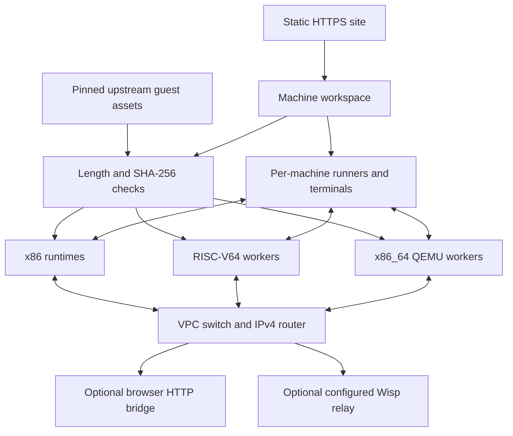

# Terrarium architecture

## Execution and ownership

Terrarium is a static React app owning independent Linux machines without a fixed count ceiling in the browser. GitHub Pages serves files; it neither executes commands nor stores remote machines. Boot fetches guest assets, verifies pinned lengths/SHA-256, and passes them to the chosen emulator.

`MachineWorkspace` owns runtimes, command runners, and network ports outside React component lifetimes. A terminal subscribes to one machine/serial port. Switching panels or remounting a React view does not recreate the guest. Removing a machine tears down its runtime, runner, port, and subscriptions.

| Profile         | Actual execution                                                                                                                                             |
| --------------- | ------------------------------------------------------------------------------------------------------------------------------------------------------------ |
| x86             | v86 0.5.472, a 32-bit PC running Linux 6.8.12, 128 MiB RAM, 2 MiB VGA memory, four UARTs.                                                                    |
| Alpine x86_64 | QEMU 8.2.0 Wasm, PC with one virtual CPU, Linux 6.12.43-0-virt, 512 MiB guest RAM, four UARTs, Alpine 3.21.4 and temporary ext4 overlay. |
| RISC-V garden   | TinyEMU 2019-12-21, a 64-bit RISC-V machine running Linux 4.15.0-00049-ga3b1e7a-dirty, 128 MiB RAM, VirtIO block/network/console devices, BusyBox 1.21.1.    |
| Alpine RISC-V64 | TinyEMU, Linux 4.15, 128 MiB RAM, official Alpine 3.24.3 userspace on an in-memory writable 9p root.                                                         |
| Debian RISC-V64 | TinyEMU, Linux 4.15, 128 MiB RAM, official Debian 13.7 slim userspace plus separately installed verified BusyBox/musl boot utilities, on a writable 9p root. |

RISC-V64 is not x86-64. No guest contains Kubernetes or an OCI runtime. The RISC-V kernel is old even when its userspace is modern; CPU architecture, distribution contents, kernel facilities, and memory are separate constraints.



The guest is not given the browser's cookies, host filesystem, model keys, or arbitrary page APIs as devices. Enabled networking is a separate host capability. This alpha is not a security-reviewed hostile multi-tenant service.

## Source boundaries

| Module                                        | Responsibility                                                                        |
| --------------------------------------------- | ------------------------------------------------------------------------------------- |
| `src/lib/machines.ts`                         | Ownership, selection, stable identity, runners, ports                                 |
| `src/lib/machine-config.ts`                   | Validated stored definitions and safe reload defaults                                 |
| `src/lib/runtime-types.ts`                    | Shared lifecycle, capabilities, serial, init, and state contracts                     |
| `src/lib/linux-runtime.ts`                    | v86 boot, UARTs, setup, lifecycle, checkpoints                                        |
| `src/lib/qemu-runtime.ts` / `public/runtime/qemu/engine.js` | Verified x86_64 downloads, shared-memory worker, boot framing, private HMP controls and isolated Ethernet |
| `src/lib/browser-isolation.ts` / `public/terrarium-isolation.js` | Explicit shared-memory setup, scoped isolation response headers and safe reload handoff |
| `src/lib/guest-capabilities.ts` | Bounded guest prerequisite observations with no Kubernetes-ready promotion |
| `src/lib/tinyemu-runtime.ts`                  | RV64 downloads, worker ownership, startup, streams, Ethernet endpoint                 |
| `public/runtime/tinyemu/worker.js`            | Isolated VM, bounded input, in-memory block assets, CPU suspension, VirtIO frames     |
| `src/lib/guest-startup.ts`                    | Script validation and shared Pocket PC/x86_64 serial-shell bootstrap |
| `src/lib/command-protocol.ts`                 | UTF-8 framing, bounded output, acknowledgment recovery                                |
| `src/lib/command-runner.ts`                   | Per-machine command locks, deadlines, results, recovery                               |
| `src/lib/agent-bridge.ts`                     | Active and explicitly addressed page APIs                                             |
| `src/lib/network.ts`                          | VPC switch/router, immutable quarantine gate, modes, guarded fetch, backend ownership |
| `src/lib/network-transport.ts`                | Adapter bus/loading, Wisp configuration, synthetic DNS                                |
| `src/lib/snapshots.ts` / `checkpoint-format.ts` | IndexedDB, typed import/export and runtime/profile validation |
| `snapshot-format.ts` / `qemu-checkpoint.ts` | Bounded v86 state and versioned QEMU checkpoint validation, hashes and passive CPU observations |
| `src/lib/preferences.ts`                      | Validated appearance settings                                                         |
| `scripts/prepare-runtime.mjs`                 | Verified v86 copy and deterministic adapter/VirtIO export shim                               |
| `scripts/prepare-tinyemu.mjs`                 | Offline verification of committed TinyEMU binaries/notices                            |

Additional modules in 0.3:

| Module                                     | Responsibility                                                                        |
| ------------------------------------------ | ------------------------------------------------------------------------------------- |
| `runtime-profiles.ts`                      | Typed registry of actual profiles and truthful capabilities/limits                    |
| `vpc-config.ts`                            | CIDR validation, VPC/subnet identities, address allocation and attachment validation  |
| `network-policy.ts` / `network-capture.ts` | Packet parsing, stateless allowlists, bounded logs and standard PCAP                  |
| `evidence.ts` / `evidence-store.ts`        | Canonical immutable logical archives, path/size/hash validation and IndexedDB storage |
| `evidence-9p.ts` / `qemu-evidence.ts`       | Host-enforced read-only 9p/ext2 evidence views and bounded x86_64 serial acquisition |
| `components/InvestigationPanel.tsx`        | Passive inspection, quarantine acquisition, read-only text/hex evidence browser       |

`evidence-transfer.ts` bounds staging reads against the pinned v86 filesystem interface before copying file bytes.

Additional modules in 0.4:

| Module | Responsibility |
| --- | --- |
| `output-stream.ts` / `components/FleetConsole.tsx` | Explicit serial transcript reads/subscriptions, reset epochs, bounded live fleet views |
| `cloud.ts` / `cloud-workspace.ts` / `control-plane.ts` | Versioned resource facade, adapter to actual workspace/store, shared UI/API singleton |
| `cloud-operations.ts` / `cloud-simulation.ts` | Per-resource serialization, truthful results/events/idempotency, opt-in mutation policies and failure injection |
| `cloud-object-store.ts` | IndexedDB bucket/object data, integrity, revisions, atomic condition checks |
| `volume-format.ts` / `volume-store.ts` | Empty ext2 generation, paged durable data, revision checks, Web Locks, immutable snapshots and clones |
| `volume-device.ts` | Real VirtIO block request handler, read-only feature/enforcement, commit-before-success and reset-epoch checks |
| `qemu-volumes.ts` / `public/runtime/qemu/block.js` | QEMU worker/host disk bridge, bounded shared-memory requests and commit-before-success |
| `dns.ts` | Bounded DNS packet parsing and actual VPC-scoped IPv4 host-record answers |
| `components/CloudPanel.tsx` | Instance lifecycle, disk management, object buckets, operation inspection, API examples |

Machine definitions have no application count ceiling. Saved-configuration parsing retains every valid definition, and idle definitions do not create emulators. Pocket PC and RISC-V guests use 128 MiB guest RAM each. QEMU x86_64 uses 512 MiB guest RAM inside a 2,300 MiB shared Wasm reservation per instance, plus additional host/image overhead. The shared QEMU admission policy permits two active/loading runtimes and 4,600 MiB accounted reservation by default. Paused runtimes retain their lease; worker/storage teardown releases it. This does not cap idle inventories or legacy runtimes and does not establish actual host capacity. See [machine settings](machine-settings.md) for preset reservations and limits.

The console view subscribes only to selected ports, batches display updates, and trims each pane to 128 Ki characters. Pausing a view unsubscribes without changing the VM. `exec()` remains a structured, bounded command-result API; it does not rely on developer-console logging.

## Genuine terminal sessions

Pocket PC and Alpine x86_64 use `ttyS0` for system/agent output. Startup creates three controlling-terminal shells on `ttyS1`, `ttyS2`, and `ttyS3`. Pocket PC explicitly configures its fourth UART; QEMU exposes all four through the kernel serial driver. Each shell has independent process/session state, cwd, environment, and foreground job ownership. A guest supervisor restarts a shell after exit.

Split view renders two distinct UARTs. It does not duplicate one terminal buffer. The agent runner uses the separate system UART, so interactive work can coexist with a bounded task. Files and processes remain shared within that machine.

TinyEMU exposes one `hvc0` console per machine. These RISC-V profiles offer one terminal without split sessions, and their runners temporarily own the shared console. QEMU uses separate bounded character-device pipes for all four UARTs. Only port 0 enters command framing; per-port transcripts, listeners and input retain their own identities.

Display history is bounded per runtime/port. Fresh reset/restore increments the display epoch so views discard old output. Appearance changes update terminal colors and app tokens without restarting guests.

## QEMU x86_64 worker

The experimental backend downloads and verifies an immutable QEMU module/Wasm build plus the Alpine kernel, initramfs, firmware and compressed root image. A dedicated module worker owns the emulator and its pthreads. Shared memory requires cross-origin isolation; an opt-in, scoped service worker can add the necessary response headers on a static host. It does not cache assets or create a guest network tunnel.

A data-only package index loads verified bytes into Emscripten FS. A bounded initramfs override mounts a temporary writable overlay and removes exact upstream demo proxy/boot assumptions. The private HMP pipe acknowledges real stop/continue commands and verifies the resulting execution state. A separate bounded in-memory socket maps the guest NIC to the same NetworkPort used by other guests. It cannot create a native WebSocket or bypass VPC/World policy.

The boot contract waits for the control console, address setup and all three interactive shell prompts before running init. It then records a read-only prerequisite probe of the resulting guest state. Missing shell readiness fails boot before user code runs. Resizing uses a serialized control command to set the specific guest TTY dimensions and a saved size file for shell respawn.

Teardown clears ownership and terminates pthreads. Boot/control deadlines and captured worker generations prevent stale output or startup continuations from operating on a replacement. Cancel boot goes directly through workspace stop instead of waiting behind the active cloud start. Cancellation retains the definition and separate disks; delete waits for teardown. A failed disk transaction remains an explicit error through the first stop attempt.

The browser and Node integration harness use the same worker dispatcher. Node runs the emulator on a real `worker_threads` worker, keeping host transactions and deadlines responsive when QEMU waits on shared memory. VM checkpoints preserve the running guest's CPU, RAM, temporary overlay and shell state. There is no source-level debugger or arbitrary image loader. Details and exact provenance are in [qemu-runtime.md](qemu-runtime.md).

## RISC-V worker

Each machine gets a dedicated classic Web Worker, isolating the upstream emulator's global `Module` and VM. The upstream JS/Wasm files are unchanged and verified against the official release.

The host supplies verified BIOS, kernel, disk, and Wasm buffers. A narrow in-memory `XMLHttpRequest` replacement serves only configuration and known block/9p payloads. New profiles use a bounded tar parser and an in-memory 9p filesystem populated from pinned, verified root archives; Debian receives a separately verified utility loader without replacing glibc. That loader cannot fetch arbitrary guest-controlled URLs. The 4 MiB ext2 image appears as sixteen 256 KiB blocks; writes remain in the VM's memory.

The upstream console FIFO is 1,024 bytes. Input is delivered in chunks of at most 64 bytes per 10 ms so large scripts do not overflow it. UTF-8 output is streamed; input/transcript sizes are bounded. Recovery interrupts clear input not yet delivered to the guest.

Pause holds pending worker timers, including the `emscripten_async_call` CPU/device loop. The message loop remains responsive; resume rearms the callbacks and destroy terminates the worker. A real-kernel test verified no guest output during pause and continued output afterward. This upstream build has no snapshot API, so checkpoint methods reject explicitly.

Neither selected runtime requires pthreads/shared memory, COOP/COEP headers, or a cross-origin-isolation service worker. Plain static hosting is sufficient for these configurations.

## Boot setup and init

Boot prepares consoles and assigns the machine's static IP. Only after setup succeeds does the network port become ready, preventing fresh/restored guests from using an unrelated address. Readiness never overrides the selected Isolated/Local/World mode.

The user's init script runs next in noninteractive `/bin/sh` with stdin at EOF and bounded command framing. Status remains `booting` and external command readiness stays false until completion. A selected World transport is usable by init. Output and exit status are captured separately.

A nonzero exit reports failure while preserving a usable shell. Timeout or broken startup protocol is explicit and may require reset. Scripts run on fresh boot/reset, never on pause/resume or snapshot restore. Normal restore repairs necessary services without rerunning user code. A passive investigation restore deliberately postpones every guest setup command until explicit resume. Script edits affect the next fresh boot.

Definitions and scripts live in local storage, which is not encrypted secret storage. Live memory and temporary root files are ephemeral unless explicitly checkpointed on Pocket PC or Alpine x86_64. Command and display histories remain page-local.

## Page agent API

`window.terrarium` targets the active machine. `get(id)` provides a stable target, and `list()` exposes identities/capabilities/state. Each machine has one runner, independent of selection and other machines' runners.

```js
const targets = window.terrarium.list();
const machine = window.terrarium.get(targets[0].id);
await machine.boot();
const result = await machine.exec('printf "hello\\n"; uname -m');
```

Commands become base64 UTF-8 data delivered in short ASCII lines. The guest creates an owned temporary script, executes it with closed stdin, restores TTY settings, and emits nonce-tagged completion with the observed exit code. Every call uses a fresh shell: guest files persist, while one call's cwd/environment changes do not establish another call's state.

Input is limited to 8 KiB, captured output to 64 KiB, and deadlines to 1–60 seconds with a 15-second default. Incomplete timeout/output-limit handling sends Ctrl-C and requires a new acknowledgment before releasing the channel. Failed recovery blocks calls until reset. Checkpoint/lifecycle interruptions cannot silently continue a command on replaced state.

The protocol is cooperative, not authenticated against the guest. Programs can forge output or interfere with their TTY; background descendants are not independently supervised. The page API is not an MCP transport or an always-on remote service.

## Networking

Each `NetworkPort` attaches to a named VPC, named /24 subnet, and validated host address. The default Garden VPC preserves `192.168.76.0/24` for older saved definitions. CIDRs can overlap across VPCs; ordinary live duplicate addresses within one VPC are rejected. Each subnet has a gateway at network+1.

The router confines ARP/broadcast/multicast to the subnet, verifies the assigned source identity, resolves NIC MAC addresses, and rewrites L2/TTL/checksums for same-VPC cross-subnet IPv4. Traffic to other VPCs is dropped before the outside backend. Unsupported protocols, malformed frames and IPv4 fragments are rejected. A generic endpoint contract supports both architectures.

Isolated drops forwarding, Local permits same-VPC traffic, and World adds the selected backend. Per-port stateless ingress/egress allowlists apply to IPv4, including return traffic. Policy, generation and source-delivery tokens reject queued stale replies after reconfiguration. Leaving World aborts fetches, closes backend connections, and prevents old reconnect callbacks from reviving them. Saved World choices reload as Local.

Quarantine is a private, irreversible port-lifetime flag constructed before restoring an investigation. It rejects attachment, transport, policy, and enabled-mode changes. It remains enforced regardless of guest setup/readiness or page-agent commands. No stored configuration can turn that flag off. Investigation and analyst instances are excluded from persisted machine definitions.

Flow metadata holds the latest 200 decisions. Optional PCAP capture holds 2,048 frames/4 MiB with a 2,048-byte snapshot length and explicit eviction counters. The capture is in-memory and does not silently persist payloads.

The pinned v86 bundle supplies its existing Fetch and Wisp implementations. Preparation adds one deterministic constructor-export shim so ports can create backends independently and lazily. Original/served hashes and the patch description are recorded in provenance. No default relay or eager socket is configured.

### Browser HTTP bridge

The Fetch backend parses guest HTTP and issues browser HTTPS requests, subject to CORS. It omits credentials/referrers, excludes local/private/app-host URLs and embedded credentials, rejects redirects, and caps a port at six simultaneous requests, 30 seconds per request, and 8 MiB per response. It buffers each finite response before delivery, allowing cancellation/size checks before exposing success; streaming is unsupported. These are app guards, not a general OS firewall or DNS-rebinding-proof remote proxy.

The x86 curl lacks HTTPS protocol support. Use `http://` in the guest; the bridge upgrades its host request. This does not install guest TLS.

The original RISC-V garden rootfs lacks glibc NSS DNS libraries, so ordinary hostname lookup fails. Startup installs `/usr/bin/webget`, invoking BusyBox wget with a numeric HTTP proxy at the virtual gateway. The target hostname reaches the Fetch backend in the absolute URI/Host header, without guest DNS. The actual installed helper, its use from init, TCP traffic, isolation, and reconnection are tested through the shared bridge.

`webget` requires World plus Browser bridge, preserves wget's exit code, and prints usage/error guidance. It does not detect host mode, set a global proxy, repair NSS, or work through Wisp. If interrupted, it may terminate before printing its own diagnostic; runner status remains authoritative.

### Wisp relay

An explicitly supplied `wss://` endpoint provides server-side sockets unavailable directly to a static browser. The port connects only when attached, ready, and in World mode. Wisp carries TCP bytes; relay policy determines reachability, and the UI exposes connection/error state. No public default is assumed. WebSockets use the browser's normal Origin and applicable relay-origin credentials/cookies; they do not offer the per-socket credential-omission option used by the fetch bridge.

With a working guest resolver, synthetic DNS addresses preserve hostnames in relay connection requests. The original RISC-V garden cannot use that resolver path and needs numeric destinations. Guest TLS support is a separate requirement: the supplied x86 curl has no HTTPS protocol and OpenSSL is absent. A secure WebSocket to the relay does not imply end-to-end TLS for guest application data. General UDP, VPN, or inbound public services are not claimed.

## Downloads and license boundaries

v86 and TinyEMU emulator files and notices are local assets. Legacy QEMU fetches its verified executable module/Wasm and guest upstream. Owned QEMU bundles serve the executable module/Wasm and shared guest from local bundle directories. Both use the local MIT pthread loader and adapters. Legacy guest files are separate downloads on Boot. x86 uses the pinned image host/BIOS commit. The original RV64 uses an immutable CORS-capable GitHub mirror whose files match the author's official TinyEMU demo archive. Alpine and Debian use pinned official rootfs image commits and source/build references recorded in TinyEMU provenance. Each file must pass length/SHA-256 checks before execution; changed bytes fail closed.

Manifests are `public/runtime/provenance.json` and `public/runtime/tinyemu/provenance.json`. Guest downloads omit credentials/referrers but reach external hosts. Downloading an image does not itself upload commands/files. Deliberate guest networking is a separate channel.

The owned Alpine guest is included in the repository/build. Its component licenses, source archive, exact historical recipes and remaining compiler/provenance limits are documented in [runtime sources](runtime-sources.md). The public source manifest identifies the companion's stable GitHub Releases download URL and integrity metadata; verify the complete archive after retrieval. Emulator licenses do not cover guest software; remotely fetched legacy guests retain their separate source limitations in the release audit.

## Checkpoints and persistence

Workspace storage holds configuration, not live VMs. Refresh/close discards execution. Persistent data disks and object buckets are separate IndexedDB resources; stop writable guests to sync guest caches before closing. Pocket PC and Alpine x86_64 support explicit IndexedDB/downloaded checkpoints; RISC-V64 does not.

At most three checkpoints are stored across the supported profiles. Pocket PC imports are limited to 256 MiB and must be trusted, uncompressed v86 format-6 states for the exact pinned four-UART, 128 MiB RAM / 2 MiB VGA profile. Single-UART, compressed and foreign states are rejected.

Alpine x86_64 uses a versioned Terrarium container with a fixed header, at most 16 KiB of manifest and at most 768 MiB of QEMU state. The manifest binds the runtime, guest asset hashes, 512 MiB RAM, four UARTs, MAC and payload SHA-256. Structural validation checks the bounded qcow2 state disk, its tables and single named VM snapshot. The parser runs before changing a live target. An arbitrary raw/qcow2 image is not a valid Terrarium checkpoint.

Normal restore blocks command input, replaces state, clears terminal history and repairs the assigned address without rerunning user init. Pocket PC also repairs its serial services. QEMU restores the saved shell processes and preserves their PIDs, environment, working directories and dimensions. Passive restore loads state with execution stopped, records the original SHA-256 and sends no guest setup or interactive input. Explicit resume performs the required setup while a quarantine port remains permanently closed.

A QEMU save pauses a running guest, observes monitor registers, attaches a private qcow2 state drive, saves VM state, detaches the drive and packages the returned bytes before resuming. An already paused guest stays paused. Only an explicit `checkpoint_rejected` result from a safe engine boundary is recoverable; protocol/device failures remain fatal. Attached data disks and evidence prevent a full VM save or restore. Browser quota/eviction still apply. A successful round trip proves the pinned profile, not arbitrary emulator compatibility.

## Evidence acquisition and mounting

Passive Pocket PC inspection reads pinned v86 format-6 CPU fields and validates bounded typed-array regions. QEMU inspection shows bounded monitor observations captured while paused at save time, preserving 64-bit register values as hexadecimal strings. Those observations are separate manifest fields, not a decode of the serialized QEMU CPU. Neither inspection executes guest instructions or supplies symbolized debugger output. The checkpoint store uses immutable IDs, preserves original bytes and verifies SHA-256 on reads; older stored v86 checkpoints acquire a digest when inspected.

Logical acquisition executes bounded commands through the owning runner under permanent network quarantine. Pocket PC transfers requested regular-file bytes through a 9p staging share. Its pinned filesystem adapter checks the inode size before a bounded read and again before copying. The upstream writable 9p backend can still allocate guest-requested staging data; archive/read limits are not a global emulator memory-safety boundary.

Alpine x86_64 stages one bounded file copy in the temporary guest root, then transfers 16 KiB chunks as base64 through the serial command channel. The host validates each decoded chunk length before assembling the file. A private acquisition lock prevents lifecycle/checkpoint changes, and the UI/resize scheduler avoids competing commands. Both profiles cap capture at 32 files, 1 MiB per file and 8 MiB total. A compromised guest can falsify content, so acquisition is explicitly labeled guest-assisted.

Archives include file hashes, source checkpoint digest when available, provenance and a canonical payload hash. Imports validate paths, structure, byte counts, base64 and every hash before use. Stored archives are add-only under their identities; deletion is explicit. The UI renders plain escaped text or hex and never interprets evidence as HTML.

A clean analyst can use Pocket PC or Alpine x86_64. Pocket PC supplies copied archive bytes through a host-side read-only 9p handler. QEMU materializes the verified archive as a bounded 32 MiB ext2 image on a separate read-only VirtIO device; its backing filesystem and QEMU drive reject mutations independently of guest file modes or mount flags. The evidence image coexists with either or both data slots and does not consume a configured volume slot.

Both runtimes mount the view at `/mnt/evidence`, preserving the `files/<original-path>` layout and `manifest.json`, and expose the archive identity/hash. Synthetic metadata describes the view, not original guest inode attributes. Evidence-mounted guests cannot save or restore full VM checkpoints because that external view is separate from VM state. Arbitrary raw/qcow2 filesystem imports, deleted-file recovery and offline parsing of the checkpoint's root filesystem are not implemented.

## Persistent data services and local cloud operations

Pocket PC and Alpine x86_64 can attach two independently configured VirtIO block slots backed by the same volume store. Both kernels mount the application's generated ext2 filesystems before user init. Stable slot identities keep `/mnt/volumes/disk1` meaningful even when slot 0 is empty. The deterministic v86 shim exports its existing VirtIO PCI transport; a separately owned block handler connects it to 64 KiB IndexedDB pages and reset epochs invalidate stale DMA completions.

QEMU exposes bounded disk files to its VirtIO block devices. Each disk has a private initial working image and a shared-memory write mailbox. The emulator worker waits for the host's asynchronous IndexedDB transaction to commit before acknowledging success; the UI thread never performs the blocking wait. Sequence, range and lifecycle checks reject stale or invalid requests. Web Locks enforce cross-tab reader/writer ownership, and atomic revision checks reject stale writes.

Writable disks are guest-synced and unmounted before manager stop/delete, and queued device/store writes drain before teardown completes. A busy mount refuses shutdown while preserving a usable guest. QEMU reset follows the same orderly disk preparation; a paused guest with writable disks must first be resumed. A shared destruction promise and a volume-operation gate prevent boot/attachment overlap with teardown. Read-only disk features and host-side mutation rejection protect immutable snapshots. Independent clones keep their own bytes. External disks and evidence are separate from VM checkpoint state, so full VM save/restore is unavailable while they are attached. See [volumes.md](volumes.md) for cache, lock, mount and durability details.

The cloud facade wraps actual manager/store calls. Compute/network/block mutations have resource locks, statuses, errors, and bounded event/idempotency history; provider completion determines success. Optional identities/faults affect mutation dispatch only. Object storage is a separate persistent IndexedDB service with hash-verified reads and atomic conditional metadata/body transactions. No remote resource backend, IMDS, S3 endpoint, or HTTP guest agent is implied. See [cloud-api.md](cloud-api.md).

Private DNS answers UDP requests sent to the subnet gateway, respecting readiness, isolation, quarantine, and ingress/egress policy. `<machine-name>.terrarium.internal` and the exact short alias resolve to their configured A record in the requester’s VPC. Names do not advertise quarantined guests and private queries do not escape to the outside transport. AAAA is NODATA; no recursive resolver or arbitrary zone service is provided.

## Appearance

Obsidian, Grove, and Daylight share semantic app/xterm tokens. Opacity affects backgrounds while text remains opaque. Blur applies to deliberate glass surfaces. Opaque/reduced-transparency and reduced-motion settings leave guest state untouched. Fonts and licenses are local.

## Primary references

- [Pinned v86 documentation](https://github.com/copy/v86/blob/cc37f35c43bf14865d74ad76879ecf9410f69eb1/Readme.md)
- [TinyEMU architecture, downloads, MIT license](https://bellard.org/tinyemu/)
- [Official JavaScript release](https://bellard.org/tinyemu/jslinux-2019-12-21.tar.gz)
- [RISC-V patches/configuration](https://bellard.org/tinyemu/diskimage-linux-riscv-2018-09-23.tar.gz)
- [Immutable asset mirror](https://github.com/losfair/jslinux-wstunnel/tree/bbc541599d2ce6d55a63f9fbd40a00da3f1b00b9)
- [GitHub Pages workflows](https://docs.github.com/en/pages/getting-started-with-github-pages/using-custom-workflows-with-github-pages)
- [Buildroot licensing guidance](https://buildroot.org/downloads/manual/manual.html#legal-info)


## Workspace lifecycle in 0.5

`workspace-persistence.ts` validates and atomically commits a versioned machine/network/selection/activity envelope. `MachineWorkspace` owns an exclusive browser-tab Web Lock, revision checks, deletion revocation, pending attachment/deletion leases, and controlled reload. `resource-events.ts` publishes post-commit storage invalidations and fences resource writes during reload. `cloud-deletions.ts` supplies dependency previews, with enforcement retained in the actual resource owners. See [workspace-lifecycle.md](workspace-lifecycle.md) for migration, empty inventories, interrupted-session handling, and exact persistence limits.
